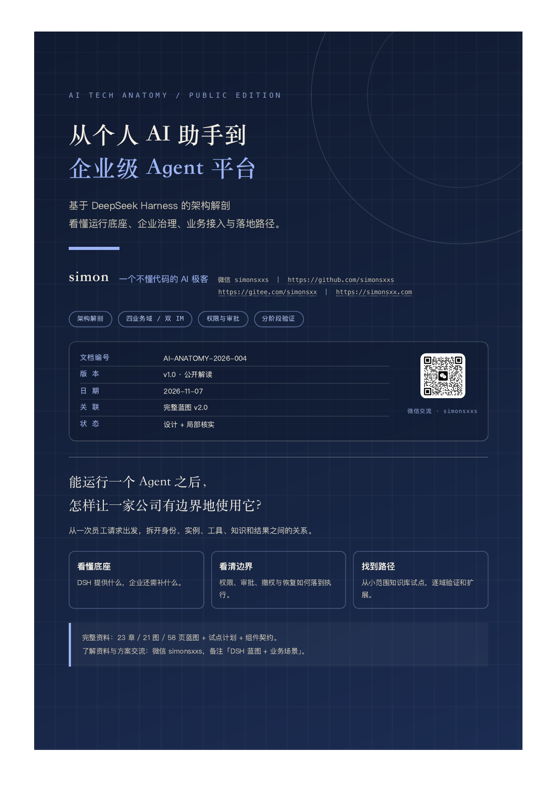
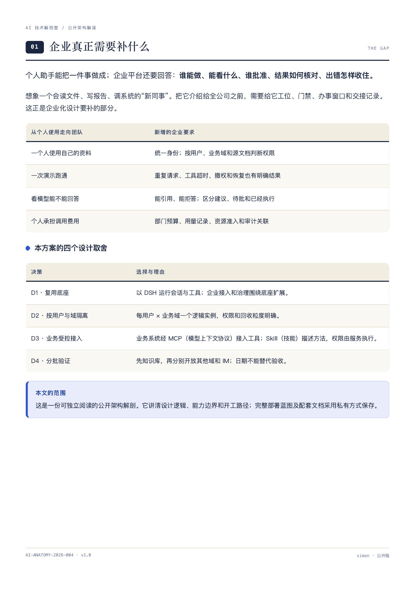
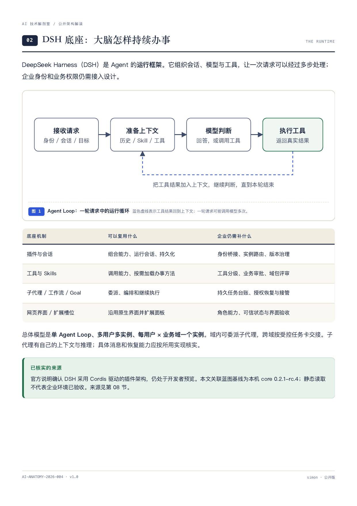
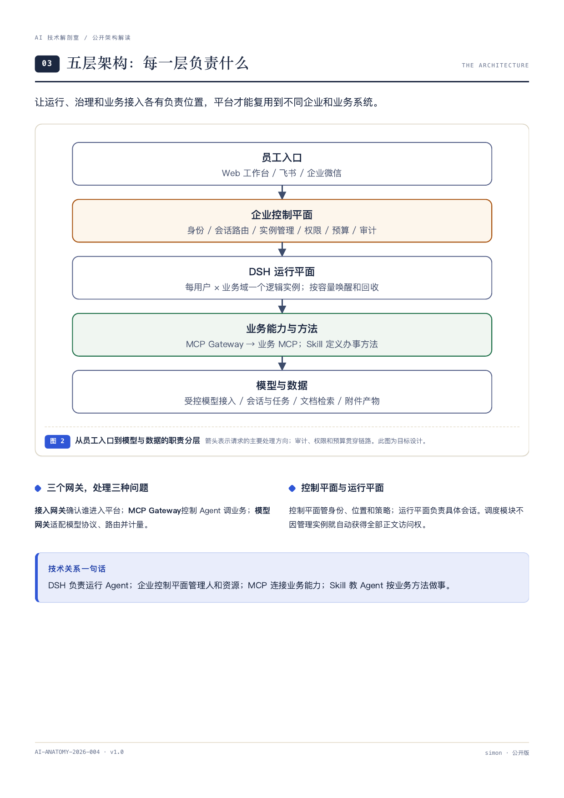
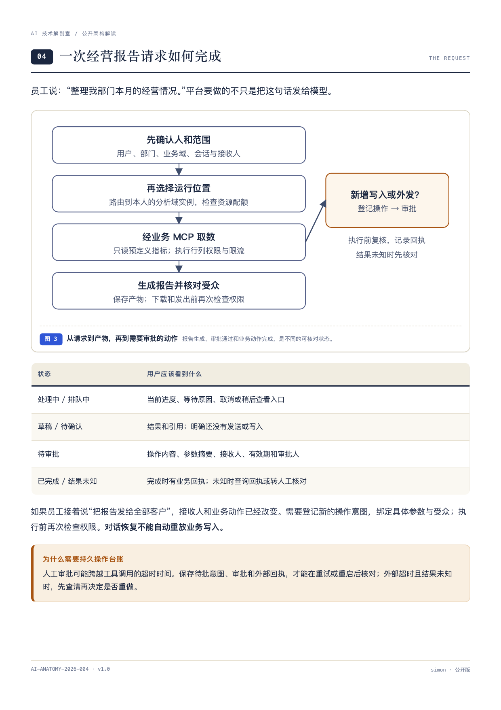
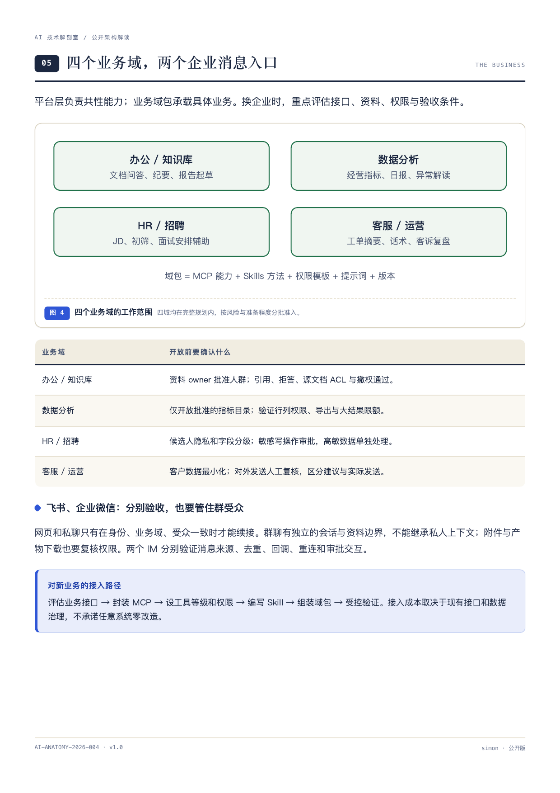
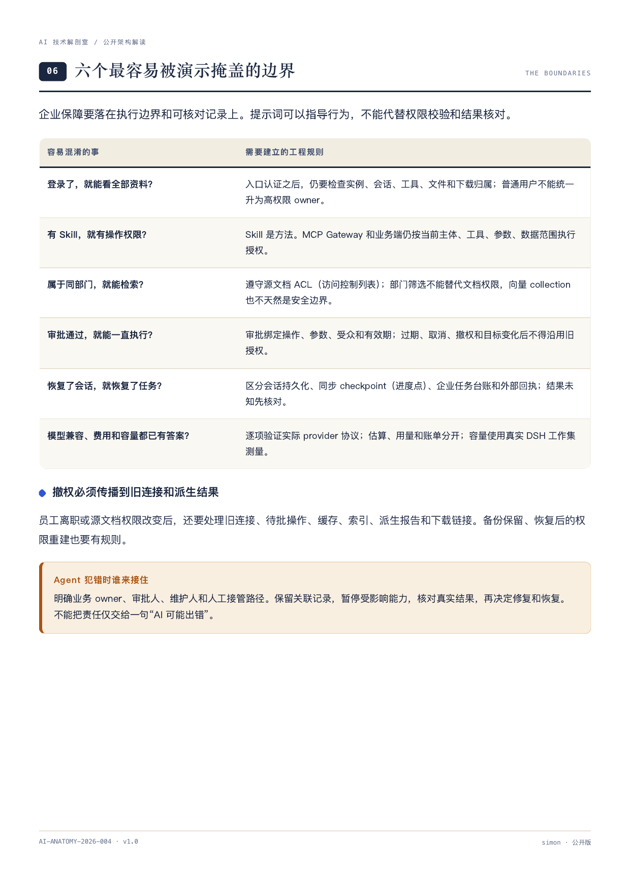
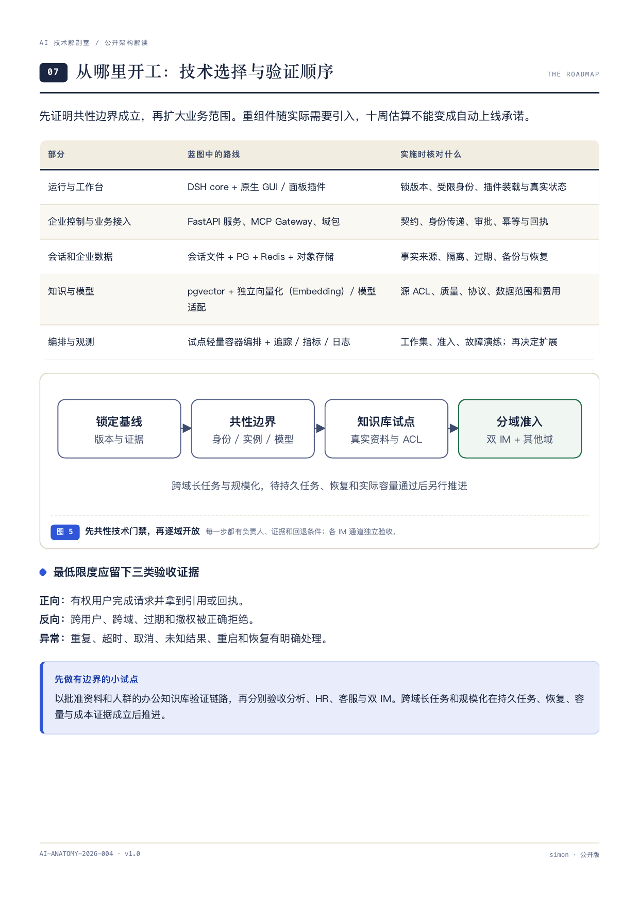
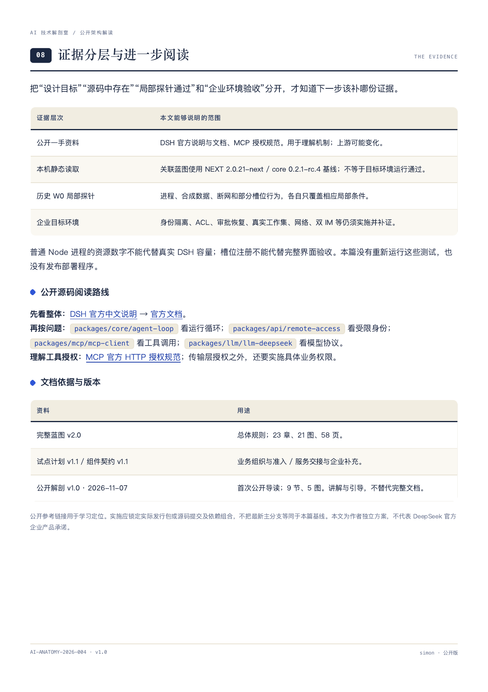
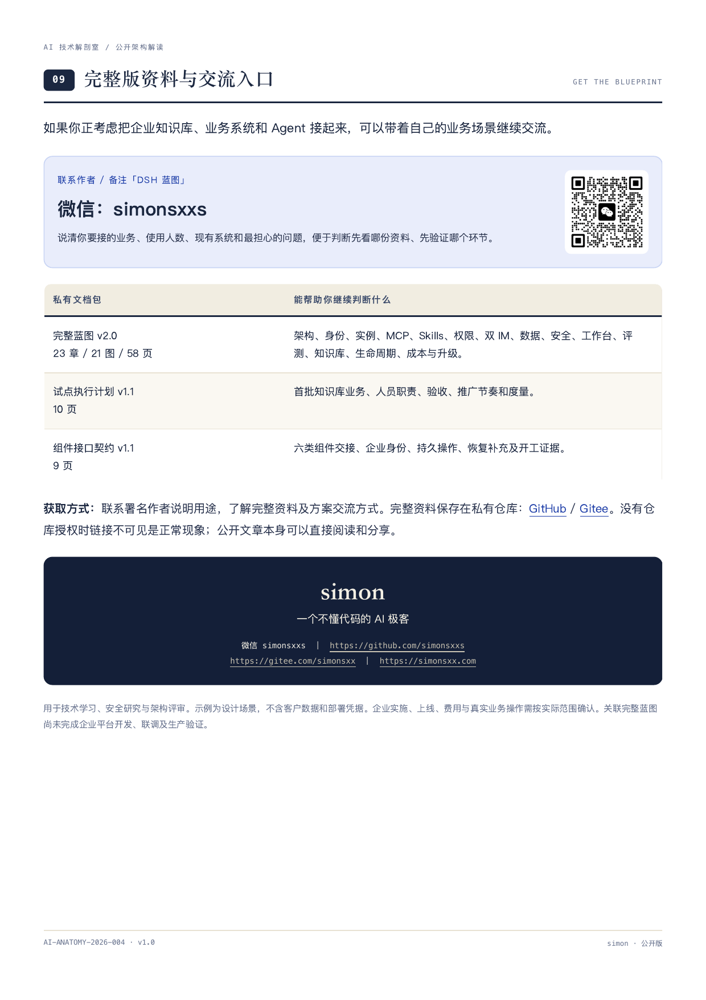

# 📖 从个人 AI 助手到企业级 Agent 平台

## 基于 DeepSeek Harness 的架构解剖 · 公开版 v1.0

> **10 页图解 · 9 节 · 5 张示意图。** 写给正在考虑企业知识库、业务系统与 Agent 接入的人：看懂 DSH 底座负责什么、企业需要补什么，以及先从哪里验证。
>
> [下载公开版 PDF](./DSH企业级Agent平台架构解剖-公开版-v1.0.pdf) ｜ [下载自包含 HTML](./DSH企业级Agent平台架构解剖-公开版.html) ｜ [返回仓库首页](../../README.md)

**完整资料与交流：微信 `simonsxxs`，备注「DSH 蓝图 + 你的业务场景」。** 完整部署蓝图、试点计划和组件契约私有保存，获取方式见[文末](#full-guide)。

**先用一句话理解：DSH 负责运行 Agent，企业控制平面管理人和资源，MCP 连接业务能力，Skill 提供办事方法。**

它适合三种读者：想判断企业 Agent 该从哪里做起的业务负责人；需要理解系统边界的架构和工程人员；想分清产品演示与企业交付的 AI 使用者。文中不把个人助手的演示成功当成企业验收，也不把这份设计描述成已经上线的平台。

**快速跳转：** [封面](#cover) · [总体架构](#architecture) · [请求链路](#request) · [业务范围](#business) · [关键边界](#boundaries) · [实施路径](#roadmap) · [完整版资料](#full-guide)

---

## 封面：从个人 AI 助手到企业级 Agent 平台

本篇从一条员工请求出发，解释 DSH、企业治理与业务系统的关系。公开图解可以独立阅读，完整蓝图另以私有方式保存。

— 第 1 页 / 共 10 页 —

## 企业真正需要补什么

个人助手能把一件事做成；企业还要管清谁能做、能看什么、谁批准、如何核对和接管。这里解释四个设计取舍：复用底座、按用户与业务域隔离、业务受控接入、分批验证。

— 第 2 页 / 共 10 页 —

## DSH 底座：大脑怎样持续办事

Agent Loop（运行循环）组织上下文、模型与工具。DSH 的会话、插件、Skills、子代理和工作流可以复用；企业身份、业务权限与持久任务仍需补齐。

— 第 3 页 / 共 10 页 —

## 五层架构：每一层负责什么

员工入口 → 企业控制平面 → DSH 运行平面 → 业务能力与方法 → 模型与数据。接入网关、MCP Gateway 和模型网关分别承担不同职责。

— 第 4 页 / 共 10 页 —

## 一次经营报告请求如何完成

确认身份和范围，路由到本人的业务域实例，经业务 MCP 取数，再生成有引用和受众边界的产物。新增写入或外发时，登记操作、审批、复核并记录真实回执。

— 第 5 页 / 共 10 页 —

## 四个业务域，两个企业消息入口

办公知识库、数据分析、HR 招聘、客服运营均在规划内。网页、飞书、企业微信分别验证身份、回调、附件与受众；群聊不能直接继承私人上下文。

— 第 6 页 / 共 10 页 —

## 六个容易被演示掩盖的边界

登录、Skill、部门、审批、会话恢复和模型兼容，都不能各自替代完整企业保障。特别要核对源文档权限、撤权传播、业务回执、协议、费用和真实实例容量。

— 第 7 页 / 共 10 页 —

## 从哪里开工：技术选择与验证顺序

锁定基线 → 共性技术门禁 → 办公知识库小范围试点 → 双 IM 和其他业务域分别准入。每步都留下正向、拒绝与异常场景证据，再决定跨域长任务和规模化。

— 第 8 页 / 共 10 页 —

## 证据分层与进一步阅读

区分设计目标、公开机制、本机静态读取、历史局部探针和目标环境验收。公开源码定位到 agent-loop、remote-access、mcp-client、llm-deepseek；实施应锁定实际版本。

— 第 9 页 / 共 10 页 —

公开参考：[DSH 官方源码与说明](https://github.com/deepseek-ai/deepseek-harness) · [DSH 官方文档](https://deepseek-harness.github.io/deepseek-harness/) · [MCP 官方 HTTP 授权规范](https://modelcontextprotocol.io/specification/2026-07-28/basic/authorization)。本篇关联的本机基线为 core 0.2.1-rc.4，上游当前代码可能不同。

## 完整版资料与交流入口

完整蓝图 v2.0 共 23 章、21 图、58 页，另有 10 页试点执行计划和 9 页组件接口契约。联系作者说明业务场景，了解资料与方案交流方式。

— 第 10 页 / 共 10 页 —

### 完整资料包含什么

| 文档 | 内容与用途 |
| --- | --- |
| 完整蓝图 v2.0 · 58 页 | 23 章、21 图，覆盖总体架构、身份与实例、MCP 与 Skills、四业务域、权限、双 IM、数据、安全、工作台、知识库、成本与升级。 |
| 试点执行计划 v1.1 · 10 页 | 首批知识库业务、组织角色、准入准出、推广节奏与度量。 |
| 组件接口契约 v1.1 · 9 页 | 六类组件交接，企业身份、持久操作、恢复及开工证据补充。 |

**联系作者：微信 `simonsxxs`，备注「DSH 蓝图」。** 建议同时说明你的业务、使用人数、已有系统和希望先解决的问题，便于找到适合的阅读与验证路径。

完整文档私有仓库：[GitHub](https://github.com/simonsxxs/dsh-enterprise-agent-blueprint) ｜ [Gitee](https://gitee.com/simonsxx/dsh-enterprise-agent-blueprint)。未获授权时链接不可见是正常现象；请联系作者了解获取方式。

### 当前交付状态

本文是公开架构解读，依据完整蓝图 v2.0、试点计划 v1.1、组件契约 v1.1，以及已读取的底座机制和局部证据编制。**企业平台尚未完成开发、接口联调或生产验收。** 本文没有重新运行 W0 测试，也不包含部署程序、客户数据或真实凭据。

---

## 关于作者

**作者：simon，一个不懂代码的 AI 极客**

- 微信交流：`simonsxxs`
- 个人网站：https://simonsxx.com
- GitHub：https://github.com/simonsxxs
- Gitee：https://gitee.com/simonsxx

用 AI 造工具、做拆解、写报告。本文用于技术学习、安全研究和架构评审；实施、发布、费用和真实业务操作应按具体范围确认。
